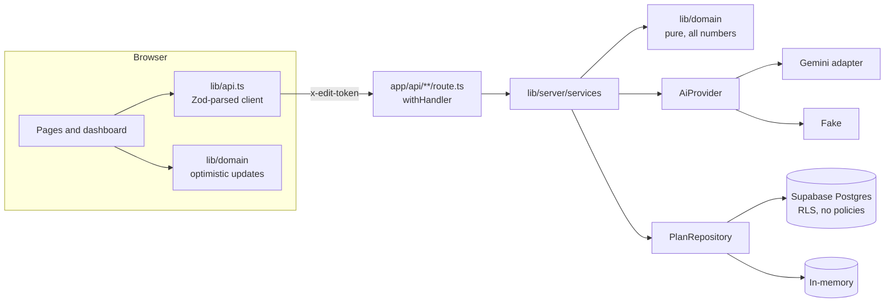

# Soirée

A GenAI planning assistant for weddings, birthdays and community events: priority-aware budgets with explained
trade-offs, date-aware timelines, vendor checklists and personal ideas. A plan is a living document: try a what-if,
see the diff, then apply or discard it.

**The LLM proposes and explains; deterministic code owns every number.** Budgets always add up exactly, and the plan
is always created, even when the model is down.

## Built for PromptWars Challenge 5: Celebration & Event Planner

> Create a GenAI-powered planning assistant that helps users organize weddings, birthdays, and community events with
> budgets, timelines, vendor checklists, and personalized ideas.

| The brief asks for | Where it lives | How GenAI and the user's context shape it |
|---|---|---|
| **Budget planner**: total split across categories, estimates labelled as estimates | Budget tab, `lib/domain/allocate.ts` | Ranked priorities get boosts, city size moves venue spend, Gemini reviews the split and explains each trade-off (guard-railed, numbers re-checked in code). Lines always add up exactly; every range says "planning estimate, not a quote" |
| **Timeline and task scheduler**: deadlines, completion, priority labels, reminders, countdown, day-of schedule | Timeline tab, `lib/domain/timeline.ts`, `dayof.ts`, `calendar.ts` | Date-aware phases (overdue work moves to "This week"); each task carries a priority label and its reason (due now, your priority, a guest need, books out early); "Add reminders to your calendar" downloads an `.ics` with a reminder the day before each task; a day-of run sheet built from guest arrival time, needs and priorities; countdown on every page. Gemini personalizes task wording from the notes |
| **Vendor checklist**: add vendors, record contacts, track quotes, pending or confirmed | Vendors tab, `lib/domain/vendors.ts` | One item per budget line with Gemini-tailored questions to ask; add your own vendors (say, two caterers to compare); record name, contact and quote; status from "not started" to "booked (confirmed)"; each quote is checked against the planning range. No invented businesses: every vendor is yours to name |
| **Personalized ideas**: themes, menu, decor, refinable by follow-up | Ideas tab, Ask drawer | Gemini ideas constrained by event type, priorities, vibes, diet, accessibility and notes; regenerate with feedback while keeping saved ideas; ask follow-up questions grounded only in the plan |
| **Smart, dynamic assistant with logical decisions** | What-if tab | Six scenarios (budget change, guest change, venue cancelled, date change, reprioritize, free text). Code computes the numbers and the diff; Gemini writes the narrative or maps free text to a scenario. Apply keeps all progress made meanwhile |

No accounts. A plan lives at two links:

- View link: `/s/{slug}` (read-only, safe to share)
- Edit link: `/plan/{slug}#edit={token}` (the token never reaches the server log or the URL bar after first open)

## Quick start (no keys)

```bash
pnpm install
AI_PROVIDER=fake DB_PROVIDER=memory pnpm dev     # PowerShell: $env:AI_PROVIDER='fake'; $env:DB_PROVIDER='memory'; pnpm dev
```

Open <http://localhost:3000>. The fake provider is deterministic and the memory store resets on restart.

## Scripts

| Command | What it does |
|---|---|
| `pnpm dev` / `pnpm build` / `pnpm start` | Next.js 16 |
| `pnpm typecheck` / `pnpm lint` | TypeScript strict; ESLint with size and complexity limits (complexity 12, 80-line functions, 250-line files) |
| `pnpm format` / `pnpm format:check` | Prettier (the check runs in CI) |
| `pnpm test` / `pnpm test:coverage` | Unit, property, service, route, security and component tests (fakes only, no network) |
| `pnpm e2e` | Playwright + axe (WCAG 2.2 AA and best practices, any impact) against the real routes with keyless providers (run `pnpm build` first) |
| `pnpm check:secrets` | Fails if a secret value or a secret-looking `NEXT_PUBLIC_` name could reach the browser |
| `pnpm smoke` | Creates plans against `BASE_URL` and prints p50/p95 latency against the budgets |

## Architecture



- `lib/domain/` is pure and shared by browser and server: templates, allocator, timeline, vendors, ideas, scenarios,
  diff, actions. Browser helpers sit beside it: `lib/api.ts` (typed client), `lib/plan-form.ts` (wizard rules),
  `lib/event-theme.ts` (event names and colours), `lib/local-plans.ts` (plans on this device).
- `lib/server/` (every file imports `server-only`): env, container, HTTP lifecycle, security, repositories, AI layer,
  services.
- Two interfaces only, both swapped by env: `AiProvider` (`AI_PROVIDER=gemini|fake`) and `PlanRepository`
  (`DB_PROVIDER=supabase|memory`).
- Every request goes through `withHandler`: request id, 16 KB body cap, content type, per-IP rate limit, token auth,
  Zod parse, service, response. Errors carry a stable `code` and a plain message.

Decisions: [ADR 0001](docs/adr/0001-llm-proposes-code-validates.md),
[ADR 0002](docs/adr/0002-capability-links.md), [ADR 0003](docs/adr/0003-providers-behind-interfaces.md).
Threat model: [SECURITY.md](SECURITY.md). Evidence: [docs/EVALUATION.md](docs/EVALUATION.md).

## API

| Endpoint | Auth | Purpose |
|---|---|---|
| `POST /api/plans` | rate-limited | Create; returns `{ slug, editToken }` once |
| `GET /api/plans/:slug` | rate-limited | Current version and history; ETag/304; `demo-*` generated on read |
| `POST /api/plans/:slug/whatif` | token | Draft a scenario (`budget_change`, `guest_change`, `venue_cancelled`, `date_change`, `reprioritize`, `custom`) |
| `DELETE /api/plans/:slug/whatif` | token | Discard the draft |
| `POST /api/plans/:slug/apply` | token | Apply the draft, keeping progress made while it was open |
| `PATCH /api/plans/:slug/tasks/:id`, `/vendors/:id`, `/ideas/:id` | token | Progress edits (compare-and-set); vendors also take name, contact and quote |
| `POST /api/plans/:slug/vendors`, `DELETE /api/plans/:slug/vendors/:id` | token | Add your own vendor (up to 20); remove only vendors you added |
| `POST /api/plans/:slug/ideas/regenerate` | token | Fresh ideas, saved ones kept |
| `PATCH /api/plans/:slug/budget` | token | Manual allocation; must add up exactly |
| `POST /api/plans/:slug/ask` | token | Grounded questions about the plan |
| `GET /api/health`, `GET /api/cron/cleanup` | none / `Bearer CRON_SECRET` | Liveness; retention |

## Production setup

1. **Supabase.** Create a project. In the SQL editor, run [`supabase/migrations/0001_init.sql`](supabase/migrations/0001_init.sql).
   Copy the project URL and a **secret** key (Project settings → API keys). Never use it in client code.
2. **Gemini.** Create an API key in Google AI Studio. Use `GEMINI_MODEL=gemini-3.6-flash`. The newer
   `gemini-3.8-flash` is listed as recommended, but in live tests (1 Nov 2026) it took 36 s or more per call or timed
   out; switch to it once it responds in a few seconds. Every request has a 50 s AI budget, so a slow model makes
   sections fall back to templates instead of failing. The Gemini **free tier allows 20 requests per day per model**
   and a new plan uses 4, so enable billing on the Google Cloud project before sharing the app. Quota errors (429)
   are not retried; affected sections fall back to templates and Ask shows "unavailable".
3. **Vercel.** Import the repo. Set these environment variables for Production (and Preview if wanted):

   | Variable | Value |
   |---|---|
   | `AI_PROVIDER` | `gemini` |
   | `DB_PROVIDER` | `supabase` |
   | `GEMINI_API_KEY` | from step 2 |
   | `GEMINI_MODEL` | `gemini-3.6-flash` |
   | `SUPABASE_URL` | from step 1 |
   | `SUPABASE_SECRET_KEY` | from step 1 |
   | `RATE_LIMIT_ENABLED` | `true` |
   | `RATE_LIMIT_SALT` | a long random string (`openssl rand -hex 32`) |
   | `CRON_SECRET` | a long random string; Vercel sends it to the cron as `Bearer` |
   | `NEXT_PUBLIC_APP_URL` | your production URL, used in copied share links |

4. **Cron.** [`vercel.json`](vercel.json) schedules `GET /api/cron/cleanup` daily at 03:00 UTC. It deletes expired
   plans (90 days) and rate-limit rows older than 2 hours.
5. Deploy, open `/api/health` (presence booleans only), then run `BASE_URL=https://your-app pnpm smoke`.

Missing variables fail fast on the first request with their names (never their values).
